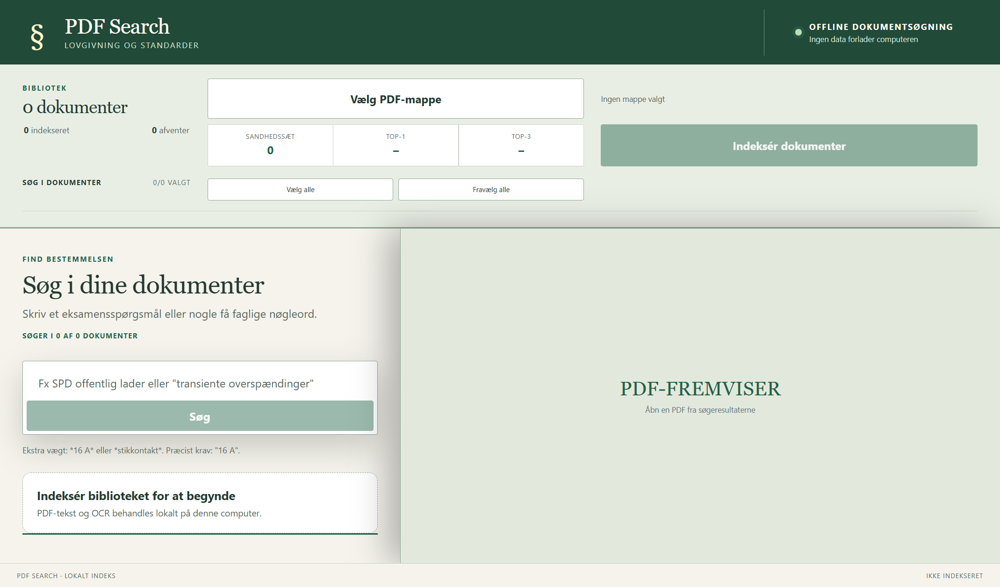

#  PDF Search

**PDF Search** er et offline Windows-program til hurtig søgning i lokale PDF-dokumenter med præcise henvisninger til dokument, fysisk PDF-side og bestemmelse. PDF-tekst, OCR, søgeindeks og et eventuelt privat sandhedssæt behandles lokalt på computeren.



## Download

Hent den nyeste version under [GitHub Releases](https://github.com/AidedPolecat6/pdf-search/releases/latest):

- `PDF Search Setup` installerer programmet i Windows.
- `PDF Search Portable` kan startes direkte uden installation.

Programmet er endnu ikke signeret med et kommercielt Windows-certifikat. Windows SmartScreen kan derfor vise en advarsel ved første start. Kontrollér, at filen er hentet fra dette repositorys officielle release-side.

## Kom hurtigt i gang

1. Start `PDF Search.exe`, eller installer programmet med `PDF Search Setup`.
2. Tryk **Vælg PDF-mappe** i venstre side.
3. Vælg den mappe, der indeholder dine PDF-dokumenter.
4. Vent, mens proceslinjen kontrollerer og indekserer dokumenterne.
5. Skriv et spørgsmål eller nogle faglige søgeord i søgefeltet.
6. Tryk **Søg**, og vælg derefter **Åbn PDF** ved det ønskede resultat.

Programmet husker den valgte mappe. Ved næste start genbruges uændrede dokumenter, mens nye, ændrede og slettede PDF-filer opdateres automatisk.

## Søgning

Du kan skrive almindelige spørgsmål eller korte faglige søgeord:

```text
SPD offentlig elbil lader
```

Programmet anvender faglige synonymer, afsnitsoverskrifter og vægtning af sjældnere matchende ord til at finde relevante formuleringer i dokumenterne. En udtrykkelig BEK/LBK-henvisning prioriterer det nævnte dokument.

Publikationer med DS-sprogdeklarationen “på engelsk” udelukkes fra søgningen. I erklæret dansk/engelske publikationer medtages kun sider markeret `(da)`. Engelske IEC-sidehoveder og sider markeret “English Version” udelukkes også. Publikationer uden disse sprogmarkeringer kræver særskilt kontrol. Filteret gælder også, når alle dokumenter er valgt.

Brug dobbelte citationstegn, når en bestemt frase skal forekomme i PDF-teksten:

```text
"30 mA" "CEE-stikkontakt"
```

Hvis søgningen indeholder flere citerede fraser, skal alle fraser forekomme i det samme resultat. Store og små bogstaver samt PDF-linjeskift påvirker ikke frasesøgningen.

### Markeringsfarver

- **Lilla:** den bestemmelse, paragraf, stykke eller det nummer, som resultatet henviser til.
- **Gul:** ord og fraser, du selv har skrevet.
- **Blå:** faglige synonymer, som programmet har fundet i PDF'en.

Markeringer fra usynlige eller beskårne tekstlag i PDF-filen filtreres fra. Fremviseren ruller først til den lilla henvisning, når den kan findes præcist.

## Dokumentoversigten

Checkboxen ud for hvert dokument bestemmer, om dokumentet indgår i søgningen.

- **Vælg alle** aktiverer samtlige dokumenter.
- **Fravælg alle** deaktiverer samtlige dokumenter.
- Ændringer slår igennem uden en ny indeksering.
- Valgene gemmes automatisk.

### Favoritter

Dokumenter, du ofte bruger, kan placeres i sektionen **Favoritter** øverst i oversigten:

1. Tryk på stjernen ud for dokumentet, eller højreklik på dokumentet.
2. Vælg **Tilføj til favoritter**.
3. Brug den samme handling for at fjerne dokumentet igen.

Favoritter påvirker ikke søgerangeringen. De gør det kun hurtigere at finde og slå bestemte dokumenter til eller fra.

## PDF-fremviseren

PDF-fremviseren er altid synlig i højre side. Når intet dokument er åbent, vises teksten **PDF-FREMVISER**.

Når du trykker **Åbn PDF**, åbnes hele dokumentet direkte på den relevante fysiske PDF-side. Søgeord og synonymer markeres uden at ændre originalfilen.

- **Scroll:** rul sammenhængende op og ned gennem dokumentet. Sidetallet følger læsepositionen; kun synlige sider og nærmeste nabosider tegnes.
- **Forrige/Næste:** spring til starten af den foregående/næste fysiske PDF-side.
- **−/+**: juster zoom.
- **Skjul markering/Vis markering:** slå markeringer til eller fra.
- **M:** skift markeringer til eller fra med tastaturet.
- **Escape:** luk dokumentet og returner fokus til knappen **Åbn PDF**.

## Søgeresultater

Hvert resultat viser:

- Dokumentnavn
- Fysisk PDF-side
- Bestemmelse eller paragraf
- Matchsikkerhed
- Om teksten kommer fra OCR

Matchsikkerhed er en deterministisk lokal relevansscore, ikke en kalibreret sandsynlighed for et korrekt svar. Den sendes ikke til en ekstern tjeneste.

## Sandhedssættet

Programmet indeholder ikke et sandhedssæt. Du kan selv oprette en privat Excel-fil, hvis kendte spørgsmål og korrekte henvisninger skal hjælpe søgerangeringen. Navnet skal begynde med `Sandheder` og slutte med `.xlsx`, for eksempel:

```text
Sandheder privat.xlsx
```

Placér filen i den samme lokale mappe som de PDF-dokumenter, du vælger i programmet. Første række skal indeholde disse kolonner:

| Kolonne | Indhold |
| --- | --- |
| `ID` | Unikt nummer eller navn |
| `Spørgsmål` | Et kendt spørgsmål |
| `Korrekt dokument` | PDF-filens navn |
| `Bestemmelse` | Korrekt paragraf eller standardpunkt |
| `Fysisk PDF-side` | Sidetallet vist i PDF-fremviseren |
| `Svar` | Kort svar |
| `Facitforklaring` | Eventuel forklaring |
| `Eventuelle nøgleord` | Alternative fagord og formuleringer |
| `Kontrolleret` | Egen status for faglig kontrol |

`Spørgsmål`, `Korrekt dokument` og `Bestemmelse` skal udfyldes. `Fysisk PDF-side` anbefales for at kunne kontrollere resultatet præcist.

Filen indlæses kun lokalt og kopieres ikke til søgeindekset eller den pakkede app. PDF Search fungerer også uden filen. Del sandhedssættet privat med personer, som må bruge indholdet; tilføj det aldrig til repositoryet.

> **PDF-filer må aldrig tilføjes til repositoryet.** Brugeren vælger selv sin lokale dokumentmappe. `.gitignore` blokerer PDF-filer som ekstra sikkerhed.

## Lokal lovoversigt

Hvis `Oversigt lovgivning PM.xlsx` ligger i den valgte PDF-mappe, indlæser programmet automatisk arkets kapitelnavne, emner og PDF-sidetal som ekstra lokal søgemetadata. Oplysningerne hjælper søgerangeringen, men kopieres ikke til søgeindekset eller den pakkede app.

Filen er lokal og ignoreres altid af Git. Programmet fungerer fortsat normalt, hvis filen ikke findes.

## Portable version

`PDF Search Portable` kræver ingen installation. Placér den portable `.exe` i en mappe, hvor du har skriverettigheder, og start den direkte.

Ved første start oprettes mappen:

```text
PDF Search Data
```

Mappen ligger ved siden af den portable `.exe` og indeholder indeks, favoritter, dokumentvalg og øvrige lokale indstillinger. Flyt både `.exe`-filen og `PDF Search Data`, hvis programmet skal flyttes til en anden placering.

PDF-dokumenterne følger ikke automatisk med. Hvis deres sti eller drevbogstav ændres, skal PDF-mappen vælges igen.

## Privatliv og offline-drift

- Ingen cloudtjeneste eller ekstern database anvendes.
- Ingen PDF-tekst eller søgning forlader computeren.
- OCR-modellerne til dansk og engelsk følger med programmet.
- Den pakkede brugerflade blokerer `http`, `https`, `ws` og `wss`.
- Windows Firewall kan bruges som en yderligere systembaseret blokering.

## Udvikling

Kræver Node.js og Windows.

```powershell
npm ci
npm run dev
```

Kontrol og builds:

```powershell
npm run typecheck
npm test
npm run package
npm run package:portable
```

- `npm run package` bygger Windows-installationsfilen.
- `npm run package:portable` bygger den installationsfrie portable version.
Repositoryet indeholder kildekode og ikon, men ingen PDF-dokumenter, sandhedssæt eller lokale søgeindeks.

## Licens

PDF Search er fri software under [GNU General Public License version 3](LICENSE), kun denne version (`GPL-3.0-only`). Copyright © 2026 AidedPolecat6.

Tredjepartskomponenter beholder deres egne kompatible licenser. Se [THIRD_PARTY_NOTICES.md](THIRD_PARTY_NOTICES.md). Licensen omfatter ikke brugerens PDF-filer eller tredjepartsstandarder.
## Prioriterede søgeudtryk

Brug fx `byggeplads *16 A* stikkontakt` til at give hele udtrykket ekstra vægt. `*16 A*` og `*16A*` genkendes ens ved vægtningen. Resultater uden udtrykket kan stadig vises. Flere udtryk kan markeres, fx `*16 A* *stikkontakt*`. Stjerner skal afsluttes parvis og må ikke blandes med citationstegn inden i samme udtryk. Citationstegn, fx `"16 A"`, kræver fortsat et præcist match. Vægtningen ændrer rangeringen, ikke betydningen af matchprocenten som ukalibreret score.

## Visuelle udgaver

Standardbygningen (`npm run build`, `npm run package` og `npm run package:portable`) bruger det offentlige, lyse tema med grønt farveskema. På brede skærme står et kompakt, scrollbart bibliotek over søgningen til venstre, mens PDF-visningen får højre side i fuld arbejdshøjde. På smalle skærme stables panelerne. `npm run build:private` bygger det mørke tema. Begge bruger samme søgning, dataformat og funktioner; forskellen er kun præsentation.

Version 0.1.1 opgraderer søgeindeksets format. Et ældre indeks genopbygges lokalt ved opstart; den første åbning efter opdatering kan derfor tage længere tid.

Efter `build:private` kan den private portable udgave pakkes med `npx electron-builder --win portable --config.directories.output=dist/current --config.compression=normal`. Kør ikke `package:portable` bagefter, da den genbygger med det offentlige tema.
